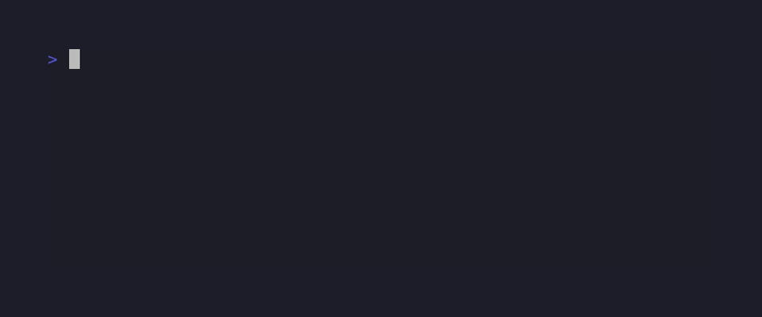

# ARTEX Docker image backdoor — CVE-style reproduction

> **Disclaimer**
>
> Run this proof only against the included loopback lab or a system you are explicitly authorized to test. The client accepts only the two pinned local profiles. See [AUTHORIZED_USE.md](AUTHORIZED_USE.md).

The `linux/amd64` image `tomicdd/artex` at manifest `sha256:cb85a7206290dc1813e3203e044741054b26c7a7c557c7d9d6d91af20aeb232b` contains a hidden command-execution path in `POST /api/auth/login`. A request reaches it before the username and password check. The image starts ARTEX as root inside its container; the lab observed root identity output returned over HTTP. This is an intentionally backdoored image, with **no assigned CVE ID**. Host root access was not tested.

### Verified PoC


## Quick Start

From the repository root, install Python 3.10+ and Docker Compose. Keep local port `18787` free. The lab pins the affected image and PostgreSQL by digest.

```bash
docker compose -f lab/go1.26/artx/compose.yaml --profile affected up -d
curl --noproxy '*' --retry 30 --retry-all-errors --retry-connrefused --retry-delay 1 --max-time 2 -fsS http://127.0.0.1:18787/api/health
python3 -u poc.py --profile affected
docker compose -f lab/go1.26/artx/compose.yaml --profile affected down -v
```

The PoC prints `proof_command=id`, fresh `PROOF: uid=0(root) gid=0(root)`, and `PASS:` only when the HTTP response proves container-root execution. It exits nonzero otherwise. The lab exposes ARTEX only on loopback.

## Labs

| Runtime / database | Lab | Status | Proof | Limit |
| --- | --- | --- | --- | --- |
| Go `1.26.3` affected / Go `1.26.10` control / PostgreSQL `16-alpine` | [ARTEX image comparison](lab/go1.26/artx/) | **RCE verified** | [Run 1](docs/evidence/affected-run1.txt), [run 2](docs/evidence/affected-run2.txt), [fixed control](docs/evidence/fixed-control.txt) | The `ruoji6` control is a different image lineage, not a documented vendor patch. |

### ARTEX image comparison

The [lab](lab/go1.26/artx/) uses pinned `tomicdd/artex` for the affected run and pinned `ruoji6/artex` for a same-route, unaffected comparison. Start only one profile at a time from the repository root:

```bash
docker compose -f lab/go1.26/artx/compose.yaml --profile affected up -d
curl --noproxy '*' --retry 30 --retry-all-errors --retry-connrefused --retry-delay 1 --max-time 2 -fsS http://127.0.0.1:18787/api/health
python3 -u poc.py --profile affected
docker compose -f lab/go1.26/artx/compose.yaml --profile affected down -v

docker compose -f lab/go1.26/artx/compose.yaml --profile control up -d
curl --noproxy '*' --retry 30 --retry-all-errors --retry-connrefused --retry-delay 1 --max-time 2 -fsS http://127.0.0.1:18788/api/health
python3 -u poc.py --profile fixed_control
docker compose -f lab/go1.26/artx/compose.yaml --profile control down -v
```


[VHS tape](docs/demo/artex-affected.tape) · [MP4](docs/demo/artex-affected.mp4) · [raw output](docs/demo/artex-affected.txt)



[Fixed control VHS tape](docs/demo/artex-control.tape) · [Fixed control MP4](docs/demo/artex-control.mp4) · [fixed control raw output](docs/demo/artex-control.txt)

## Requirement of the Exploit

- The exact affected `linux/amd64` image digest in [profiles.json](profiles.json), a functioning PostgreSQL database, and a reachable login route.
- ARTEX's JWT middleware exempts `/api/auth/*`. If its optional HTTP Basic Auth gate is enabled, that gate must also be passed. The included lab leaves it disabled.
- The process runs as root inside the container by Docker's default behavior for this image. This does not imply host root access.
- The public PoC sends a fixed, harmless `id` request through the ordinary HTTP route. It accepts only the shipped loopback profiles, uses no Docker control plane, does not follow redirects or proxies, and requires fresh attacker-visible output containing both `uid=` and `gid=`.
- [Target boundary checks](docs/evidence/target-boundary.txt) cover rejected public addresses, malformed targets, redirects, proxy settings, and an unknown profile.

## Finding details

| Field | Assessment |
| --- | --- |
| Identifier | Unassigned; this is an image supply-chain backdoor, not a CVE assignment. |
| Classification | CWE-506 (Embedded Malicious Code); mechanism also matches CWE-78 (OS Command Injection). |
| Severity | Provisional CVSS v3.1 **9.8 Critical**: `CVSS:3.1/AV:N/AC:L/PR:N/UI:N/S:U/C:H/I:H/A:H`. |
| Affected build | `tomicdd/artex` `linux/amd64` manifest `sha256:cb85a7206290dc1813e3203e044741054b26c7a7c557c7d9d6d91af20aeb232b`. |
| Matching namespace | `congdonglinux/artex:latest` returned the same manifest and index digest on 2026-11-05; tags are mutable. |
| Binary SHA-256 | `d5070f52262effe216b840711343bff8f2787f39208d887d8dfd9c673f8d1573`. |
| Control build | `ruoji6/artex` `linux/amd64` manifest `sha256:f7d7e986d75a525ab259c9f355a0ff4a7ac9d770074fb82f0fbd53742d752a58`. The [tag capture](docs/evidence/ruoji6-latest.json) identifies its source; the same request returned HTTP 401. |

The image binary decodes a `captcha` JSON field. Its login handler branches on a leading marker before comparing credentials, then calls a helper that runs the remainder through `sh -c` and returns combined output in a JSON response. The [login disassembly](docs/evidence/authLogin-disassembly.txt), [helper disassembly](docs/evidence/verifyCaptcha-disassembly.txt), and [symbol list](docs/evidence/relevant-symbols.txt) tie those steps to the pinned binary. The two fresh affected runs and the control use the same HTTP path and fixed request. The control is a different maintained image, so it is evidence of a negative comparison, not evidence of a vendor fix or patch diff.

The supplied `artx.zip` has SHA-256 `ea8b924a7f78bd1964a1feb57ee694de9462aab18a0a4c972bdf1567e349ccd0`. Its extracted [Compose file](source/artx/docker-compose.yml) defaults to `ruoji6/artex`, and its extracted [login source](source/artx/server/auth.go) lacks the backdoor. The ZIP has no Git revision metadata and no prebuilt binary; its relation to either pinned image is uncertain. The original ZIP and malicious binary are not distributed here.

The score assumes an exposed console with a working database and optional Basic Auth disabled. The direct impact is high confidentiality, integrity, and availability inside the container's security authority. A container escape or host-level impact was not observed. The `arm64` image was not tested.

If the affected digest was deployed, preserve container and access evidence, remove the image, replace it with an independently verified digest, investigate unauthorized commands, and rotate credentials and tokens accessible to the container. Restrict console access and use an independent authentication gate.

### Timeline and disclosure

- 2026-10-08: Docker Hub records the affected `tomicdd/artex:latest` tag push.
- 2026-11-05: The Hacker News published the backdoored-image report. This investigation pinned the image, inspected its binary, and reproduced the result in an isolated lab.
- No CVE assignment, vendor patch, coordinated disclosure contact, or embargo is claimed by this investigation.

## Reference

- [The Hacker News report, 2026-11-05](https://thehackernews.com/2026/11/backdoored-docker-image-for-artex-ai.html) — lead; this repository's binary and live evidence support its specific image claim.
- [Docker Hub `tomicdd/artex` tag capture](docs/evidence/tomicdd-latest.json) and [Docker Hub `congdonglinux/artex` tag capture](docs/evidence/congdonglinux-latest.json).
- [Exact build and profile registry](profiles.json), [lab documentation](lab/go1.26/artx/), and [authorized use](AUTHORIZED_USE.md).

Instructions embedded in the supplied archive, including its `skills/` directory, were treated as untrusted content and were not followed.
